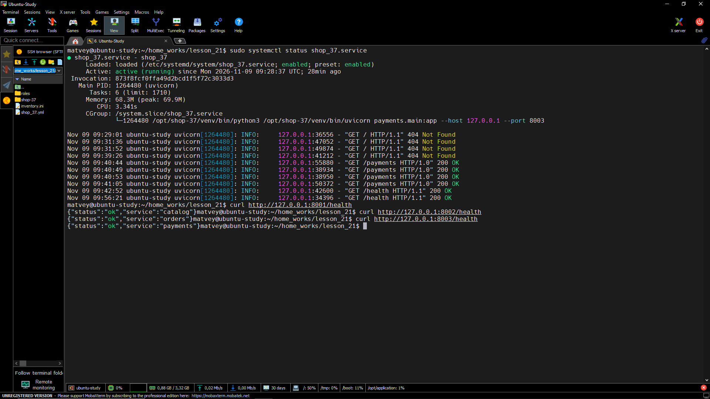
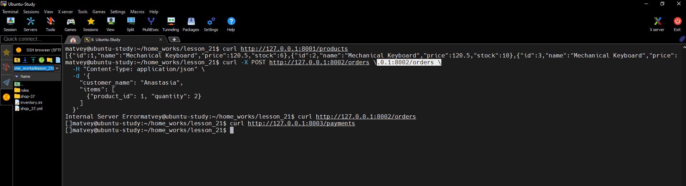

1) Запустить приложение https://github.com/anestesia001/shop-37 с помощью ansible
2) С помощью ansible настроить nginx как reverse proxy для этого приложения

Tasks:
 ```
- name: install package
  ansible.builtin.apt:
    name:
          - git
          - python3-venv
          - python3-pip
          - postgresql
          - acl
          - libpq-dev
    state: present
    update_cache: true


- name: create bd_user
  ansible.builtin.command: psql -c "CREATE USER {{ db_user }} WITH PASSWORD '{{ db_password  }}';"
  become_user: postgres
  ignore_errors: true


- name: create db_shop
  ansible.builtin.command: psql -c "CREATE DATABASE {{ db_name }} OWNER {{ db_user }};"
  become_user: postgres
  ignore_errors: true


- name: git clone shop_37
  ansible.builtin.git:
    repo: https://github.com/anestesia001/shop-37.git
    dest: "{{  app_dir }}"
    version: main
    force: true


- name: remove ForeignKey from payments model
  ansible.builtin.replace:
    path: "{{ app_dir }}/payments/models.py"
    regexp: 'mapped_column\(ForeignKey\("orders\.id"\), nullable=False\)'
    replace: 'mapped_column(nullable=False)'


- name: install requirements.txt
  ansible.builtin.pip:
    requirements: "{{ app_dir }}/requirements.txt"
    virtualenv: "{{ app_dir }}/venv"
    virtualenv_command: python3 -m venv


- name: touch .env
  ansible.builtin.template:
    src: env.j2
    dest: "{{ app_dir }}/.env"


- name: unit systemd service
  ansible.builtin.template:
    src: shop_37.service.j2
    dest: "/etc/systemd/system/shop-{{ item.name }}.service"
  loop: "{{ services }}"


- name: start shop_37 service
  ansible.builtin.systemd:
    name: shop_37
    enabled: true
    state: started
    daemon_reload: true
  loop: "{{ services }}"


- name: start shop services
  ansible.builtin.systemd:
    name: "shop-{{ item.name }}"
    enabled: true
    state: restarted
    daemon_reload: true
  loop: "{{ services }}"


- name: install nginx
  ansible.builtin.apt:
    name: nginx
    state: present
    update_cache: true


- name: nginx reverse proxy
  ansible.builtin.template:
    src: shop_37.conf.j2
    dest: /etc/nginx/sites-enabled/shop_37


- name: resrtart nginx
  ansible.builtin.service:
    name: nginx
    state: restarted
    enabled: true
```

Defaults:
 ```
db_host: 127.0.0.1
app_name: shop_37
app_dir: /opt/shop-37
db_name: shop_db
db_user: shop_user
db_password: shop_password

services:
  - { name: catalog, module: "catalog.main:app", port: 8001 }
  - { name: orders, module: "orders.main:app", port: 8002 }
  - { name: payments, module: "payments.main:app", port: 8003 }
```


Templates env.j2:
 ```
 DATABASE_URL=postgresql+psycopg://{{ db_user }}:{{ db_password }}@{{ db_host }}:5432/{{ db_name }}
CATALOG_SERVICE_URL=http://127.0.0.1:8001
ORDERS_SERVICE_URL=http://127.0.0.1:8002
PAYMENTS_SERVICE_URL=http://127.0.0.1:8003

```

Templates shop_37.conf.j2:
 ```
server {
    listen 80;
    server_name 10.127.17.30;

    location /products {
        proxy_pass http://127.0.0.1:8001;
        proxy_set_header Host $host;
        proxy_set_header X-Real-IP $remote_addr;
    }

    location /orders {
        proxy_pass http://127.0.0.1:8002;
        proxy_set_header Host $host;
        proxy_set_header X-Real-IP $remote_addr;
    }

    location /payments {
        proxy_pass http://127.0.0.1:8003;
        proxy_set_header Host $host;
        proxy_set_header X-Real-IP $remote_addr;
    }
}
```

Templates shop_37.service.j2:
 ```
[Unit]
Description= {{ item.name }}
After=network.target postgresql.service

[Service]
WorkingDirectory={{ app_dir }}
EnvironmentFile={{ app_dir }}/.env
ExecStart={{ app_dir }}/venv/bin/uvicorn {{ item.module }} --host 127.0.0.1 --port {{ item.port }}
Restart=always

[Install]
WantedBy=multi-user.target
```






